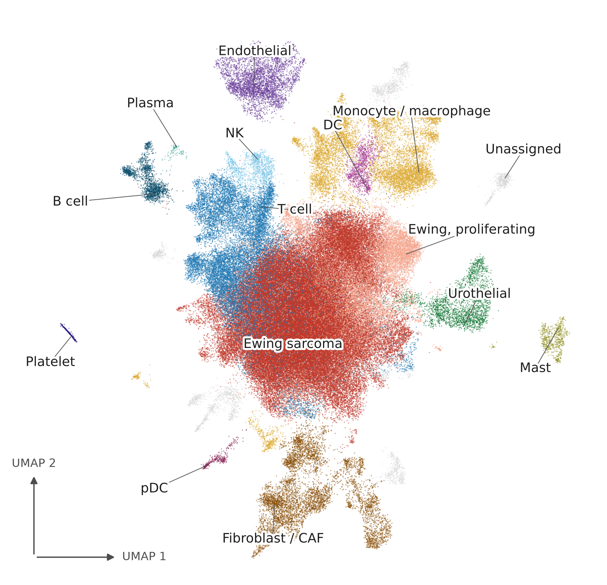

# EWSAtlas 

Harmonized single-cell / single-nucleus reference for Ewing sarcoma (EWSR1::FLI1-driven),
built in the spirit of NBAtlas (Bonine et al., *Cell Reports* 43:114804, doi 10.1016/j.celrep.2024.114804).

**EWSAtlas** harmonizes the public single-cell and single-nucleus record for
EWSR1::FLI1 Ewing sarcoma into one reference: **138,353 cells × 16,622 genes,
6 studies, 65 samples, 38 donors**, processed under one quality-control policy,
one gene space, one controlled vocabulary and one annotation pipeline. The
embedding above is the released scVI latent space, coloured by the 14 assigned
cell-type labels plus `Unassigned` (2.0% of cells). Integration reduces study
structure without removing it: the share of same-study nearest neighbours falls
from 0.984 unintegrated to 0.760, against 0.338 expected under random mixing,
and part of that residual reflects genuine composition differences between
cohorts. 
